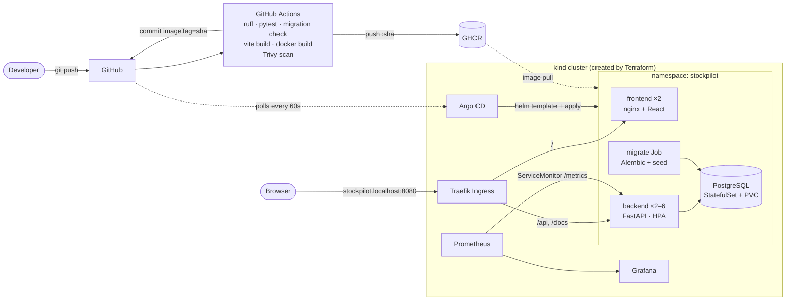

# StockPilot

[](https://github.com/whenommmm/stockpilot/actions/workflows/ci-cd.yml)

**StockPilot is an inventory-management dashboard.** A small business uses it to track products,
record stock coming in (restocks) and going out (sales, corrections), see which items are running
low, and know what the stock on hand is worth.

It is also a DevOps capstone: the same app travels from a laptop through tests, a security-gated
CI pipeline and a container registry, onto a Kubernetes cluster built with Terraform, deployed by
Helm and Argo CD, autoscaled, and monitored with Prometheus and Grafana.

| Inventory dashboard | Adjusting stock |
|---|---|
| KPI cards, a searchable/filterable product table with stock meters, and a live activity feed | Every quantity change is a recorded movement, and overselling is refused |

## Features

- **Products**: create, edit and delete products with SKU, category, supplier, unit price (₹) and reorder level
- **Stock movements**: restock, sale or correction. Quantity can *only* change through a movement,
  so there is a full audit trail. The API refuses any movement that would take stock below zero.
- **Stock status**, calculated from quantity and reorder level: `IN_STOCK`, `LOW_STOCK` (at or below reorder level), `OUT_OF_STOCK`
- **Dashboard**: products, units on hand, inventory value, low/out-of-stock counts (click them to filter), recent activity
- **Ops endpoints**: `/health` (liveness), `/ready` (readiness, checks the DB), `/metrics` (Prometheus), `/docs` (Swagger)
- The sidebar shows the **UI and API build SHAs**, so you can see a deployment land

## Architecture



| Layer | Technology |
|---|---|
| Frontend | React 19 + Vite 8, served by non-root nginx |
| Backend | Python 3.13, FastAPI, SQLAlchemy 2, Pydantic 2, Alembic |
| Database | PostgreSQL 17 |
| Tests and quality | pytest (25 tests), ruff, Alembic drift check |
| Containers | Multi-stage Dockerfiles, Docker Compose |
| CI/CD | GitHub Actions, Trivy, GitHub Container Registry, Dependabot |
| Infrastructure | Terraform: kind (local, applied) and AWS VPC + EKS (validated) |
| Kubernetes | Helm, Traefik Ingress, HPA, metrics-server, Pod Security "restricted" |
| GitOps | Argo CD |
| Observability | kube-prometheus-stack: Prometheus, Grafana, ServiceMonitor, PrometheusRule |

## Repository layout

```text
.
├── backend/                FastAPI app, Alembic migrations, pytest suite, Dockerfile
├── frontend/               React app, nginx config template, Dockerfile
├── docker-compose.yml      Full local stack
├── .github/workflows/      CI/CD pipeline
├── terraform/
│   ├── local/              kind cluster (applied)
│   └── aws/                VPC + EKS (validated and tested, not applied)
├── k8s/                    Namespace + Argo CD Application
├── helm/stockpilot/        Helm chart (+ Grafana dashboard JSON)
├── platform/               Values for Traefik, metrics-server, Argo CD
├── monitoring/             Values for kube-prometheus-stack (Prometheus + Grafana)
├── scripts/                Platform install, local image loading, load test
├── troubleshooting/        Broken manifests + step-by-step lab
└── docs/                   Build plan and demo script
```

## Run it locally with Docker Compose

Needs Docker with Compose.

```bash
docker compose up --build
```

| URL | What |
|---|---|
| <http://localhost:3000> | StockPilot UI |
| <http://localhost:8000/docs> | API docs (Swagger) |
| <http://localhost:8000/metrics> | Prometheus metrics |

Start-up is ordered with health checks: `postgres` (healthy) → `migrate` (Alembic + demo data,
exits 0) → `backend` (healthy) → `frontend`. Stop with `docker compose down`, or add `-v` to
delete the database volume too.

Inspect the database:

```bash
docker compose exec postgres psql -U stockpilot -c '\dt' -c 'select sku, name, quantity from products;'
```

## Tests

```bash
cd backend
python -m venv .venv && source .venv/bin/activate
pip install -r requirements-dev.txt
ruff check . && ruff format --check .
pytest -v
```

The 25 tests cover every endpoint, including validation errors, 404/409/422 paths, stock rules,
stats and metrics. Each test gets a fresh schema in a temporary **SQLite** database, so tests never
touch PostgreSQL. To run the same suite against Postgres, set `TEST_DATABASE_URL`.

## CI/CD

[`.github/workflows/ci-cd.yml`](.github/workflows/ci-cd.yml) runs on every push and pull request to `main`:

| Job | What it does | Fails the build when |
|---|---|---|
| Backend · lint + tests | `ruff check`, `ruff format --check`, `pytest -v` | lint error or failing test |
| Database · migration check | Against a Postgres service: `alembic upgrade head` → `alembic check` → `downgrade base` → `upgrade head`, then seeds twice | broken migration, or models changed without a migration |
| Frontend · build | `npm ci && npm run build` | build error |
| Image · backend / frontend | Build with `APP_VERSION=<sha>` → **Trivy** → push `ghcr.io/<owner>/stockpilot-<component>:<sha>` (main only) | fixable HIGH/CRITICAL CVE |
| Deploy · bump image tag | Writes the SHA into `helm/stockpilot/values-local.yaml` and commits it | — |

- **Image tags are the full commit SHA**, never `latest`, so every running pod traces back to one commit.
- **Every third-party action is pinned to a commit SHA.** Version tags can be moved: in March 2026
  attackers re-pointed almost all `aquasecurity/trivy-action` tags at code that stole CI secrets
  (CVE-2026-33634). The pipeline uses trivy-action v0.36.0 running Trivy v0.75.0.
- **Dependabot** opens weekly PRs for GitHub Actions, pip, npm and Docker base images.

### GitOps

CI never holds cluster credentials. It changes one line in Git, and **Argo CD** (inside the
cluster) notices within a minute and rolls the new images out:

```text
git push → CI green → images :<sha> in GHCR → "deploy(local): stockpilot <sha>" commit → Argo CD sync → rolling update
```

## Infrastructure as Code (Terraform)

See [`terraform/README.md`](terraform/README.md).

- `terraform/local` creates the **kind** cluster the project runs on: `init → plan → apply → destroy`.
- `terraform/aws` is the production-style design: VPC with 2 public + 2 private subnets across 2 AZs,
  a NAT gateway, an EKS cluster with a managed node group, the EBS CSI driver with a default gp3
  StorageClass, and metrics-server. It passes `terraform validate` and `terraform test`, which
  plans it against a mocked AWS provider. It is **not applied**, so the project costs nothing.

## Kubernetes: from zero to running

```bash
# 1. Cluster (Terraform)
terraform -chdir=terraform/local init
terraform -chdir=terraform/local apply

# 2. Add-ons: Traefik, metrics-server, Prometheus + Grafana, Argo CD
./scripts/platform-up.sh

# 3a. GitOps deploy (images from GHCR, tag managed by CI)
kubectl apply -f k8s/argocd-application.yaml

# 3b. ...or deploy directly with Helm using locally built images
./scripts/load-local-images.sh
helm upgrade --install stockpilot helm/stockpilot -n stockpilot -f helm/stockpilot/values-local.yaml
```

| URL | What | Login |
|---|---|---|
| <http://stockpilot.localhost:8080> | StockPilot through the Ingress | — |
| <http://stockpilot.localhost:8080/docs> | API docs | — |
| <http://grafana.localhost:8080> | Grafana ("StockPilot · Service & Inventory" dashboard) | `admin` / `stockpilot` |
| <http://prometheus.localhost:8080/targets> | Prometheus targets | — |
| <http://argocd.localhost:8080> | Argo CD | `admin` / printed by `platform-up.sh` |

`*.localhost` resolves to your machine in Chrome, Edge and Firefox without any `/etc/hosts` change.

What the chart deploys into the `stockpilot` namespace:

- **PostgreSQL** StatefulSet with a PersistentVolumeClaim (`PGDATA` in a subdirectory, so a fresh
  volume's `lost+found` doesn't break `initdb`)
- **migrate** Job (Alembic + demo data), run by Argo CD after the database is healthy and before the apps
- **backend** Deployment (2–6 pods via HPA) and **frontend** Deployment (2 pods), both with
  readiness/liveness probes, zero-downtime rolling updates, resource requests/limits, non-root
  users, read-only root filesystems and all Linux capabilities dropped
- **ClusterIP Services**, one **Ingress** (`/api`, `/docs` → backend; `/` → frontend)
- **HorizontalPodAutoscaler** (CPU, target 60%)
- **ServiceMonitor**, **PrometheusRule** (backend down, 5xx ratio, out-of-stock) and a **Grafana dashboard**

The namespace enforces the **restricted Pod Security Standard**, so a pod that runs as root or keeps
capabilities is rejected.

### Autoscaling demo

```bash
kubectl get hpa,pods -n stockpilot -w      # terminal 1
./scripts/load-test.sh                     # terminal 2: 50 clients for 3 minutes
```

The backend goes from 2 pods towards 6 as CPU passes 60% of its request, then scales back down
about a minute after the load stops.

## Observability

- `/metrics` exposes HTTP request counts, latency histograms (5 ms to 2.5 s buckets) and sizes per
  endpoint, plus business metrics: `stockpilot_products`, `stockpilot_low_stock_products`,
  `stockpilot_out_of_stock_products`, `stockpilot_inventory_value` and
  `stockpilot_stock_adjustments_total{reason}`.
- The Grafana dashboard shows request rate, p95 latency, 5xx ratio, CPU per pod, HPA replicas
  (current/desired/max), units moved by reason, and inventory health.

## Troubleshooting lab

[`troubleshooting/README.md`](troubleshooting/README.md) walks through an `ImagePullBackOff`, a
Service with no endpoints, a pod stuck at `0/1 READY`, and Argo CD self-healing a manual change.

## Security measures

- Every container runs as a non-root user, and the backend and frontend use read-only root filesystems
- The namespace enforces the restricted Pod Security Standard
- Trivy blocks images with fixable HIGH/CRITICAL CVEs. The first scan found 4 HIGH CVEs in libraries
  bundled inside `pip`; the runtime image no longer ships pip at all.
- Actions are pinned to commit SHAs, and Dependabot keeps dependencies current
- No credentials are committed: Terraform state, `.env`, `*.tfvars` and the kind kubeconfig are git-ignored
- CI has no cluster access (pull-based GitOps)

## Fixes over the TaskBoard reference

The Session 21 reference has bugs that would have cost marks. StockPilot avoids all of them:

| Reference problem | StockPilot |
|---|---|
| Terraform used multi-argument one-line blocks, so `terraform init` failed | Formatted HCL; `validate` and `terraform test` pass |
| A pytest test failed (`no such table`) | Isolated DB fixture; 25 tests pass |
| Compose backend raced Postgres and exited | Health-gated start-up order with a one-shot migrate service |
| Frontend nginx ran as root | `nginx-unprivileged` (UID 101) |
| nginx hard-coded upstream `backend` and crashed in Kubernetes | Upstream from `BACKEND_URL`, resolved per request |
| Ingress pointed at a Service name and port that didn't exist | Names come from one Helm helper; checked with `helm template` |
| Migrations ran in every replica at start-up | Single migrate Job / Compose service |
| `trivy-action@0.30.0` (a hijacked tag) | v0.36.0, pinned by SHA |
| ingress-nginx (retired March 2026) | Traefik |

## Clean up

```bash
docker compose down -v                        # local Compose stack
terraform -chdir=terraform/local destroy      # the whole kind cluster
```
